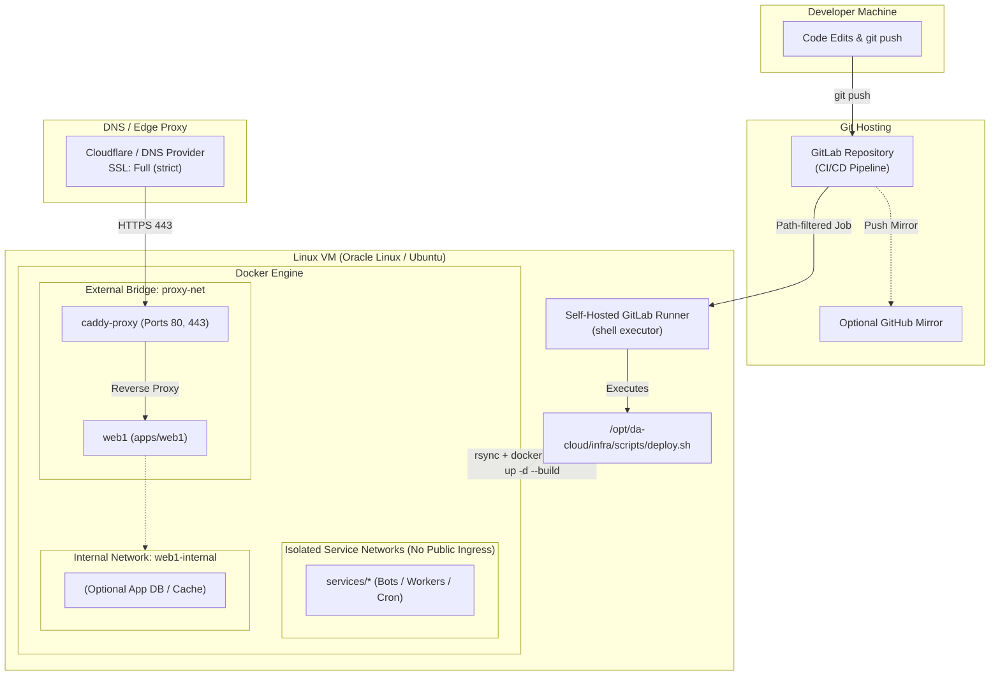

# `da-cloud` — Architecture & Operations Reference

## 1. Architecture Overview

### Design Principles

1. **Strict `.env` Enforcement:** Every `docker-compose.yml` sets `required: true` on its `.env` file, and `deploy.sh` checks that `/opt/da-cloud/<service-path>/.env` exists before building or starting containers.
2. **Network Segmentation:**
   - `proxy-net` is an external bridge network shared only between `caddy-proxy` and public-facing web containers (`apps/*`).
   - Each web app also has its own `internal: true` bridge network (e.g., `web1-internal`) so databases or Redis instances are only reachable by their parent web app, never by other apps on the VM.
   - Background workers (`services/*`) are never attached to `proxy-net`, preventing accidental public HTTP exposure.
3. **Selective Redeployment:** Modifying `apps/web1` only rebuilds and restarts `web1` without interrupting `caddy-proxy` or other running containers.
